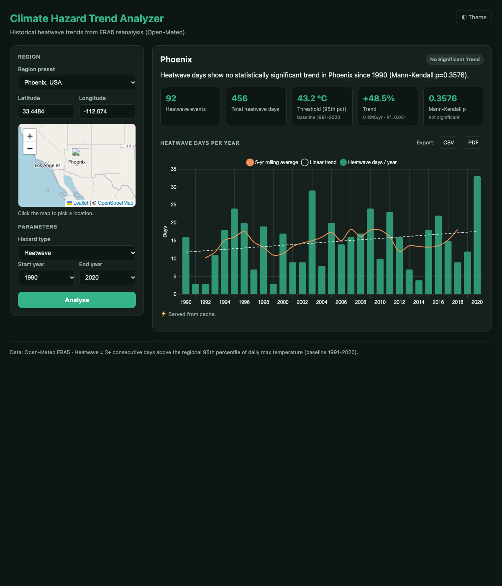

# Climate Hazard Trend Analyzer

A full-stack web app that analyzes historical weather data and visualizes trends in climate
hazards — focused on **heatwaves** — for any region over a chosen time range.

It fetches daily temperature records from the Open-Meteo ERA5 archive, detects heatwaves using
a percentile-based climatological definition, quantifies the long-term trend with both a linear
regression and the non-parametric Mann-Kendall test, caches everything in MongoDB, and presents
it through an interactive React dashboard with a map, charts, and CSV/PDF export.

> **Live demo**
> - Frontend (Vercel): `https://<your-app>.vercel.app`  ← _fill in after deploy_
> - Backend (Render):  `https://<your-api>.onrender.com` · [`/docs`](https://<your-api>.onrender.com/docs)



---

## Architecture

```
┌──────────────┐    HTTPS    ┌──────────────────────┐    HTTPS    ┌──────────────────┐
│ React (Vite) │ ──────────▶ │ FastAPI (Python)     │ ──────────▶ │ Open-Meteo ERA5  │
│  Vercel      │   /api/*    │  Render              │   archive   │  (public API)    │
│  Chart.js    │ ◀────────── │  heatwave + trend    │ ◀────────── │                  │
│  Leaflet     │    JSON     │  logic, rate-limit   │             └──────────────────┘
└──────────────┘             │        │ cache                     
                             │        ▼                           
                             │  ┌──────────────┐                  
                             │  │ MongoDB Atlas │  raw + computed  
                             │  │  (NoSQL)      │  cache w/ TTL    
                             └──┴──────────────┘                  
```

- **Frontend** (`frontend/`): React + Vite, Chart.js for the time-series, Leaflet for map-based
  region selection. Deployed on **Vercel**.
- **Backend** (`backend/`): FastAPI. Fetches + caches weather data, runs the hazard and trend
  logic, exposes a clean JSON API. Deployed on **Render**.
- **Database**: **MongoDB Atlas** (NoSQL). Two collections — `raw_weather` (raw upstream pulls)
  and `analysis_cache` (computed results) — both with TTL indexes for automatic expiry.
  If no `MONGODB_URI` is set, the backend transparently falls back to an in-memory cache so it
  still runs locally (reported via `/api/health`).

---

## Data source

**[Open-Meteo Historical Weather API](https://open-meteo.com/en/docs/historical-weather-api)**
(ERA5 reanalysis). Chosen because it is:

- **Free and keyless** — ideal for a public deployment with no secret management.
- **Deep** — daily data from **1940** to the near-present, globally gridded.
- **Reliable** — consistent schema; `daily` arrays for `temperature_2m_max`, `temperature_2m_min`,
  `precipitation_sum`.

The client (`backend/app/services/weather.py`) adds request timeouts, exponential-backoff
retries, and defensive parsing that preserves missing values (`null`) instead of silently
dropping days, so downstream logic can reason honestly about data coverage.

---

## Hazard logic (heatwave)

Definition (per the brief):

> A **heatwave** is a run of **3 or more consecutive days** where the daily maximum temperature
> exceeds the region's **95th percentile** of daily max temperature.

Implementation (`backend/app/services/hazards.py`):

1. **Threshold** — the 95th percentile of daily max temp over a fixed **climatological baseline
   (default 1991–2020, the WMO climate normal)**. Using a fixed baseline means the "hot" bar stays
   constant, so trends are measured against a stable reference rather than a moving target.

   To make that guarantee real, the backend **widens the upstream fetch** to
   `min(start_year, baseline_start) … max(end_year, baseline_end)` before computing the
   percentile. Without this, a request for 1960–1989 would never download any baseline years and
   the threshold would silently be derived from the very record whose trend is being measured —
   different windows would return different thresholds and the results would not be comparable.
   The widened span is cached and shared across requests for the same point, so it costs no extra
   upstream calls in practice.

   If the baseline genuinely cannot be covered (fewer than ~365 valid days), the response sets
   `baseline_fallback: true`, reports the window actually used in `baseline`, and emits a warning
   stating that the threshold is not comparable across regions or ranges. It never claims a
   baseline it did not use.
2. **Event detection** — scan the daily series for runs of 3+ days above the threshold.
3. **Per-year aggregation** — number of events, total heatwave days, mean event duration, peak
   intensity (°C above threshold), and **data coverage** (fraction of expected days present).

**Trend analysis** (`backend/app/services/trends.py`):

- **5-year rolling average** to smooth year-to-year noise on the chart.
- **Linear regression** — slope, R², and a p-value (normal-approximation of the t-test, accurate
  for ~30-year series). Percent change is computed from the *fitted* endpoints, not noisy raw
  values.
- **Mann-Kendall test** — non-parametric, outlier-robust trend test with tie correction; the
  preferred significance signal for short, noisy climate series.
- The headline insight is generated honestly: it states the direction, the magnitude, and
  whether the trend is statistically significant (and says so plainly when it is **not**).

---

## API

Base path: `/api`

| Method & path | Description |
|---|---|
| `GET /api/health` | Liveness + which cache backend is active. |
| `GET /api/regions` | Curated city presets (name → lat/lon) for the dropdown. |
| `GET /api/analyze` | Run analysis. Query: `lat`, `lon`, `start_year`, `end_year`, `hazard=heatwave`, `region_name?`. Returns the yearly series, trend stats (`slope_per_year`, `r_squared`, `p_value`, `mann_kendall_*`, `significant`), `threshold_celsius` with `baseline` / `baseline_fallback` / `baseline_days` provenance, the headline `insight`, a `cached` flag, and `warnings[]`. |
| `GET /api/export` | Same params + `format=csv\|pdf`. Downloads the report. |

Interactive docs are auto-generated at **`/docs`** (Swagger UI).

---

## Security & performance

- **Input validation** (Pydantic): latitude ∈ [-90, 90], longitude ∈ [-180, 180], year bounds
  (≥ 1940, not in the future), and a max span guard (80 years). Invalid input → `422` with a
  concise message.
- **Rate limiting** (`slowapi`): per-IP, default `30/minute` (configurable via `RATE_LIMIT`),
  applied with `@limiter.limit` decorators on every endpoint and covered by
  `tests/test_rate_limit.py`. Note: `SlowAPIMiddleware` is deliberately **not** used — since
  Starlette 1.7 / FastAPI 0.143, `include_router` routes sit behind an `_IncludedRouter` wrapper,
  so slowapi's route-handler lookup returns `None`, treats every `/api/*` request as exempt, and
  the configured limits are parsed but never enforced. The decorators bypass that lookup. See
  `app/rate_limit.py`.
- **CORS**: locked to the configured frontend origin(s) via `ALLOWED_ORIGINS`.
- **Caching**: two-level (raw + computed) in MongoDB with TTL indexes. A warm request is served
  from cache in ~0.1s vs ~1s+ cold, and avoids hammering the upstream API.
- **Error hygiene**: upstream/internal errors are logged server-side and returned as clean
  generic messages — no stack traces or upstream details leak to the client.
- **Safe upstream access**: 5xx/429 responses are retried with exponential backoff; other 4xx
  responses are **not** retried (our request was malformed — retrying only delays the answer and
  hammers the provider). Request timeouts are enforced, and the archive end date is clamped to
  the provider's availability lag so a valid user request can't produce an upstream 400.
- **Export filenames**: `region_name` is reduced to `[A-Za-z0-9._-]` before being interpolated
  into the `Content-Disposition` header, so a quote in user input can't terminate the value.

---

## Local setup

**Prerequisites:** Python 3.11+ and Node 18+. MongoDB is optional locally (in-memory fallback).

### Backend

```bash
cd backend
python3 -m venv .venv && source .venv/bin/activate
pip install -r requirements-dev.txt
cp .env.example .env          # optional: set MONGODB_URI for real caching
uvicorn app.main:app --reload --port 8000
# API at http://127.0.0.1:8000  ·  docs at http://127.0.0.1:8000/docs
```

Run the tests:

```bash
cd backend && pytest        # hazard logic, trend math, validation, rate limiting, cache layer
```

### Frontend

```bash
cd frontend
npm install
echo "VITE_API_BASE_URL=http://127.0.0.1:8000" > .env.local
npm run dev                  # http://localhost:5173
```

---

## Deployment

### Backend → Render

1. Create a **MongoDB Atlas** free (M0) cluster. Add a database user and allow network access
   (`0.0.0.0/0` for simplicity, or Render's egress IPs). Copy the connection string.
2. On Render, **New → Blueprint** and point it at this repo (the `backend/render.yaml` blueprint
   sets build/start commands and the health check), **or** create a Web Service manually with:
   - Root directory: `backend`
   - Build: `pip install -r requirements.txt`
   - Start: `uvicorn app.main:app --host 0.0.0.0 --port $PORT`
   - Health check path: `/api/health`
3. Set environment variables in the Render dashboard:
   - `MONGODB_URI` = your Atlas connection string
   - `ALLOWED_ORIGINS` = your Vercel URL (e.g. `https://your-app.vercel.app`)
   - (others from `.env.example` are optional; defaults are sensible)

### Frontend → Vercel

1. **New Project** → import this repo → set **Root Directory** to `frontend`.
2. Framework preset: **Vite** (build `npm run build`, output `dist`).
3. Environment variable: `VITE_API_BASE_URL` = your Render URL
   (e.g. `https://climate-hazard-api.onrender.com`).
4. Deploy. `vercel.json` handles SPA routing.

> Note: Render's free tier sleeps after inactivity, so the **first** request after idle can take
> ~30s to cold-start. Subsequent requests are fast.

---

## Assumptions

- **Fixed baseline (1991–2020)** for the percentile threshold (WMO-standard climate normal). The
  upstream fetch is widened to guarantee the baseline years are actually present (see *Hazard
  logic*). If the baseline still cannot be covered, the fallback is reported explicitly via
  `baseline_fallback` and a warning — never silently relabelled.
- **Single-point, not area-averaged.** A region resolves to one ERA5 grid cell (~25 km) at the
  given lat/lon, not a spatial average over a city or state boundary.
- **Trailing years may be incomplete.** The ERA5 archive lags real time by ~5 days, so a request
  ending in the current year returns a partial final year. That year's counts are genuinely lower
  as a result, which biases the fitted trend downward, so the response warns when the last year
  has < 99% coverage.
- **Single missing day** inside a hot run does **not** break the run (treated as non-informative);
  **two+ consecutive** missing days do. Gap days are never counted as heatwave days.
- Events are attributed to the **year of their start date**.
- A by-construction note: with a fixed 95th-percentile threshold, ~5% of baseline days exceed it,
  so some stable/desert climates legitimately show **no significant trend** — the app reports this
  honestly rather than manufacturing a headline. The UI de-emphasises a percent change whenever
  the trend is not statistically significant, so a large-looking number is never presented as a
  finding.
- **Annual (not day-of-year) percentile.** The threshold is a single percentile over all days of
  the year, so by construction a "heatwave" can essentially only occur in the warm season. The
  ETCCDI convention instead uses a day-of-year percentile computed over a ±5-day moving window,
  which would also surface anomalous warmth in spring or autumn. See *What I'd improve*.
- Only **heatwave** is fully implemented; drought / heavy-rainfall are stubbed for extensibility.

---

## What I'd improve with more time

- **Day-of-year percentile thresholds** (ETCCDI-style, ±5-day window) so the definition can detect
  out-of-season heat rather than only summer extremes — the single biggest limitation of the
  current hazard rule.
- **More hazards**: implement drought (e.g. SPI from precipitation) and heavy-rainfall (Rx1day /
  R95pTOT) using the same pipeline — the hazard layer is already structured for it.
- **Spatial aggregation**: support a lat-lon *box* (area average over a grid) rather than a single
  point, with the Leaflet rectangle tool.
- **Confidence intervals** on the regression line in the chart, and Sen's slope alongside
  Mann-Kendall.
- **Background pre-warming / scheduled refresh** of popular regions to hide cold starts.
- **Auth + usage quotas** and a proper APM/metrics dashboard for production hardening.
- **E2E tests** (Playwright) and CI to run pytest + build on every push.

---

## AI tools used

- **Claude (Claude Code)** — used as a pair-programmer to scaffold the project structure, draft
  the FastAPI backend and React frontend, write the hazard/trend logic and its unit tests, and
  produce this documentation. All climate-logic decisions (fixed baseline, gap handling,
  Mann-Kendall choice), the architecture, and the final review were directed and verified by me;
  I ran the tests and the end-to-end flow to confirm correctness.

---

## Project layout

```
backend/
  app/
    main.py            app factory: CORS, rate limiting, lifespan, router
    config.py          env-driven settings
    models.py          Pydantic schemas + input validation
    rate_limit.py      shared slowapi limiter (decorator-based, see docstring)
    db.py              Mongo (Motor) connection + in-memory fallback
    regions.py         curated region presets
    export.py          CSV + PDF generation
    routers/analysis.py  /health /regions /analyze /export
    services/
      weather.py       Open-Meteo client (retry, timeout, gap-safe parsing)
      hazards.py       percentile threshold + heatwave detection + yearly summary
      trends.py        rolling mean, linear regression, Mann-Kendall, insight text
      cache.py         fetch→compute→store orchestration + cache keys
  tests/               pytest: hazards, trends, validation, rate limiting, cache layer
  render.yaml          Render blueprint
frontend/
  src/
    App.jsx            dashboard layout + state
    api/client.js      fetch wrapper (base URL from env)
    hooks/useAnalysis.js
    components/        RegionPicker, MapPicker, TimeRange, HazardSelect,
                       TrendChart, InsightCard, ExportButtons
    styles/app.css     clean dashboard theme (light/dark)
  vercel.json
```
